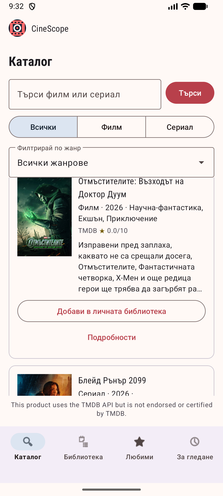
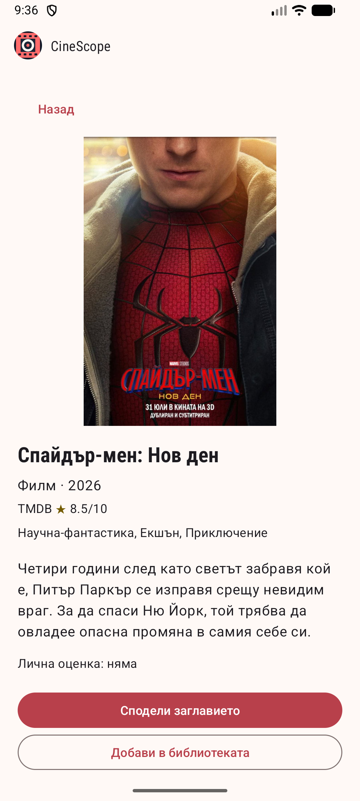
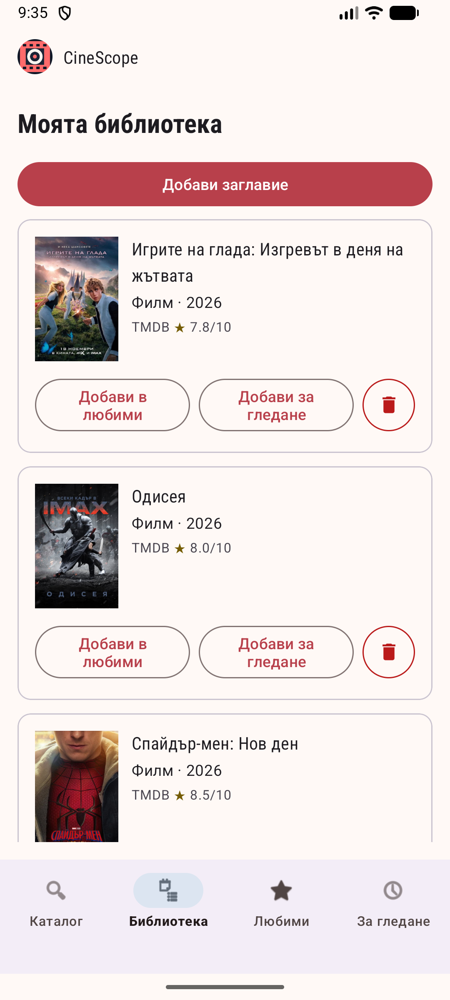
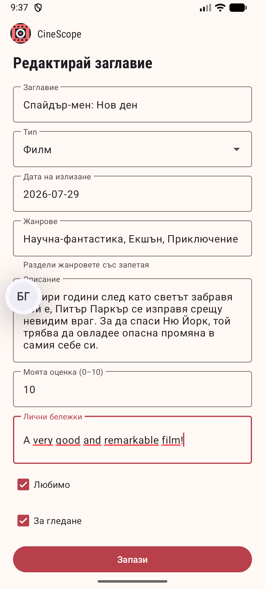
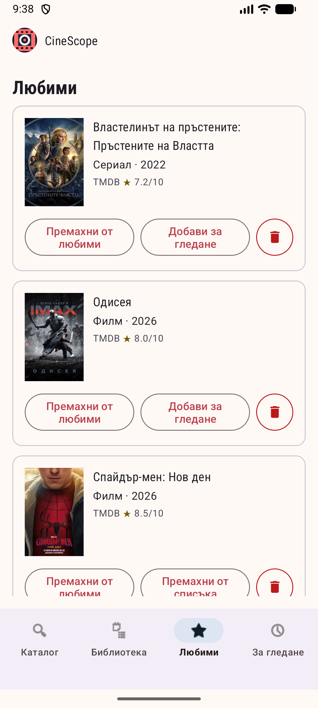
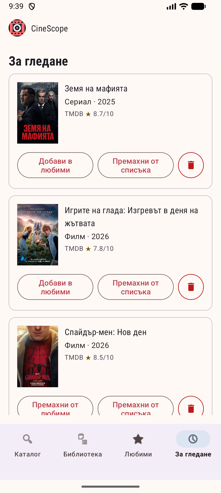

# MobileApps2026-2401321081

# CineScope

CineScope е Android приложение за откриване на филми и сериали и поддържане на лична библиотека. Проектът използва Kotlin, Room и TMDB API.

**GitHub:** [MobileApps2026-<2401321081>]([https://github.com/<потребител>/MobileApps2025-<ФН>](https://github.com/IvoKraichev/MobileApps2026-2401321081))

## Идея

Приложението съчетава онлайн каталог с локална библиотека. В каталога потребителят може да разглежда популярни заглавия, да търси филми и сериали и да филтрира резултатите. Избрано заглавие може да бъде добавено в личната библиотека, отбелязано като любимо или запазено за гледане. За личните записи могат да се съхраняват оценка и бележки. Данните в библиотеката остават на устройството след затваряне и повторно стартиране на приложението.

## Как работи

Началният екран зарежда популярни заглавия от TMDB. Потребителят може да потърси филм или сериал, да филтрира резултатите по тип и жанр и да отвори подробности за заглавие. Оттам може да го сподели чрез системния Share Intent или да го добави в личната библиотека. Личните записи се съхраняват локално в Room и се показват в отделни списъци за библиотека, любими заглавия и списък за гледане. Формата за запис позволява добавяне и редактиране, а библиотеката предоставя изтриване. За онлайн каталога е необходим TMDB Read Access Token. Без него локалната библиотека остава достъпна, но зареждането на каталога и търсенето онлайн няма да работят.

## Основни възможности

- Каталог с популярни филми и сериали от TMDB
- Търсене на филми и сериали
- Филтриране по тип медия и жанр
- Екран с подробности, постер, жанрове, дата, описание и оценки
- Лична библиотека с добавяне, преглед, редактиране и изтриване
- Лична оценка и бележки към запис
- Списъци с любими заглавия и заглавия за гледане
- Споделяне на заглавие чрез Share Intent
- Material 3 тема с автоматично превключване между светъл и тъмен режим

## Архитектура

Приложението следва MVVM с Repository слой. Зависимостите се предоставят чрез ръчен контейнер `AppContainer`.

| Слой       | Отговорност                                                                                         |
|------------|-----------------------------------------------------------------------------------------------------|
| UI         | Fragment-ите показват каталога, подробностите, библиотеката и формата за запис.                     |
| ViewModel  | Подготвя UI състоянието и обработва действията от екраните.                                         |
| Repository | Отделя интерфейсите за локалните записи и онлайн каталога от конкретните им реализации.             |
| Data       | `RoomMovieRepository` работи с Room; `TmdbCatalogRepository` зарежда и преобразува данните от TMDB. |
| DI         | `AppContainer` създава и предоставя базата данни и repository обектите.                             |

Основните екрани са свързани с Navigation Component. Room използва DAO и Entity за съхранение на личните записи в локалната база данни `cinescope_db`.

## Технологии

| Технология                         | Конфигурация в проекта |
|------------------------------------|------------------------|
| Език                               | Kotlin                 |
| Минимален Android SDK              | 24                     |
| Compile SDK                        | 37                     |
| Target SDK                         | 37                     |
| Java source и target compatibility | 11                     |
| Android Gradle Plugin              | 9.4.1                  |
| Room                               | 3.0.3                  |
| AndroidX Lifecycle                 | 2.11.0                 |
| Navigation                         | 2.10.2                 |
| Retrofit                           | 3.0.0                  |
| Coil                               | 3.3.0                  |
| Material Components                | 1.14.0                 |
| Unit тестове                       | JUnit 4.13.2           |
| UI тестове                         | Espresso 3.7.0         |

Версиите на библиотеките са описани в `gradle/libs.versions.toml`.

## Потребителски поток

1. При стартиране се отваря каталогът с популярни заглавия.
2. Потребителят търси заглавие или избира филтър за тип медия и жанр.
3. Докосва резултат, за да отвори подробностите.
4. От подробностите може да сподели заглавието или да го добави в личната библиотека.
5. В библиотеката може да създаде запис, да го отвори и редактира, да отбележи любимо или за гледане, или да го изтрие.
6. Промените се записват локално и остават налични след рестарт на приложението.

## Архитектура на екраните

- **Каталог** — популярни заглавия, търсене и филтри
- **Подробности** — информация за избрано заглавие и действия за споделяне или добавяне
- **Библиотека** — лични записи с опции за добавяне, редактиране и изтриване
- **Любими** — записите, отбелязани като любими
- **За гледане** — записите, запазени за гледане
- **Форма за заглавие** — въвеждане или редактиране на личен запис

## Стъпки за стартиране

### Необходими инструменти

- Android Studio с Android SDK за API 37
- JDK 25 за Gradle daemon toolchain
- TMDB Read Access Token за онлайн каталога и търсенето

### От Android Studio

1. Клонираме публичното GitHub хранилище.
2. Отваряме проекта в Android Studio и изчакваме Gradle синхронизацията.
3. За достъп до TMDB задаваме токена като Gradle свойство `TMDB_READ_ACCESS_TOKEN`.
4. Стартираме конфигурацията `app` на емулатор или Android устройство.

## Тестови акаунти

CineScope няма регистрация, вход или потребителски акаунти. Не са необходими тестови данни за вход. Онлайн каталогът изисква TMDB Read Access Token, зададен локално в Gradle настройките.

## Тестове

Unit тестовете са в `app/src/test`. Инструменталният Espresso тест проверява основния сценарий за добавяне на заглавие в библиотеката.

## Скрийншотове

Скрийншотовете се намират в директорията `docs/screenshots`. Ето и визуализацията им:

### 1. Каталог

### 2. Подробности

### 3. Лична библиотека

### 4. Форма за заглавие

### 5. Любими заглавия

### 6. Списък за гледане

## APK

Release APK файлът е в [`apk/app-release.apk`](apk/app-release.apk).